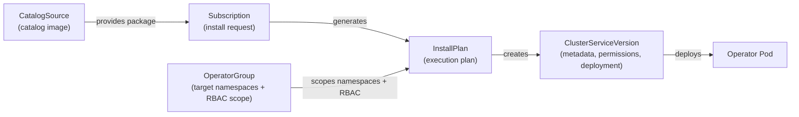
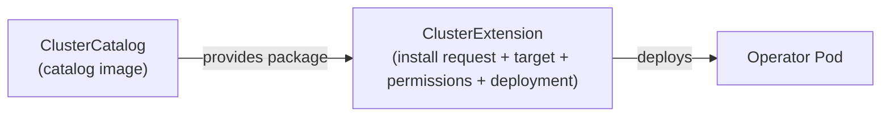

# Enable AllNamespaces Install Mode for OADP Operator

## Abstract

- Enable `AllNamespaces` install mode alongside the existing `OwnNamespace` mode in a single CSV.
- The operator's cache is no longer restricted to its own namespace — a single operator instance now reconciles one `DataProtectionApplication` (DPA) per tenant namespace, each driving its own independent Velero deployment.

> **Scope note:** This document originally proposed AllNamespaces install mode with runtime behavior unchanged (the operator would still watch only its own namespace). That scope has since expanded: implementing AllNamespaces install mode made cluster-wide watching straightforward enough that it was done as part of the same effort, so this document now also covers true multi-tenant DPA support. The original "watch only own namespace" framing is preserved below in Background/OLM context, but Goals, Non-Goals, Detailed Design, and Validation reflect the current, broader scope.

## Background

### OLMv0 — Current model

OLMv0 uses a five-resource model:

- **`CatalogSource`** — where to find operators (catalog image)
- **`OperatorGroup`** — which namespaces the operator watches + RBAC generation
- **`Subscription`** — install request
- **`InstallPlan`** — auto-generated execution plan
- **`ClusterServiceVersion` (CSV)** — the operator's metadata, permissions, and deployment spec



OLMv0 supports four install modes: `AllNamespaces`, `OwnNamespace`, `SingleNamespace`, and `MultiNamespace`. This multi-tenancy model allowed multiple independent operator instances in different namespaces, each watching its own scope. OADP currently uses `OwnNamespace`, meaning the operator only watches CRs in the namespace where it is installed.

### OLMv1 — The new model

[OLMv1](https://www.redhat.com/en/blog/announcing-olm-v1-next-generation-operator-lifecycle-management) is a ground-up redesign that consolidates the five OLMv0 resources into two:

- **`ClusterCatalog`** — replaces `CatalogSource`
- **`ClusterExtension`** — replaces `OperatorGroup` + `Subscription` + `InstallPlan` + `CSV`



It is declarative, GitOps-friendly, and uses a cluster-admin security model instead of namespace-scoped ServiceAccount RBAC.

**OLMv1 GA only supports AllNamespaces mode.** The rationale, as documented in the [OLMv1 single/own namespace enhancement proposal](https://github.com/openshift/enhancements/pull/1849):

1. **CRDs are cluster-scoped singletons.** Only one definition of a CRD can exist per cluster. OLMv0's multi-tenancy promise — that multiple operator instances in different namespaces could each own their own CRDs — was architecturally flawed.
2. **Dependency resolution requires a global view.** OLMv1's explicit dependency model cannot work at namespace scope.
3. **PSA and security are simpler at cluster scope.** Managed platforms (ROSA, OSD) operate cluster-admin anyway.

`OwnNamespace` and `SingleNamespace` were added as Tech Preview in OCP 4.19 ([OCPSTRAT-1711](https://issues.redhat.com/browse/OCPSTRAT-1711)) behind the `TechPreviewNoUpgrade` feature gate — a cluster-wide toggle that, while enabled, blocks upgrading to the next OCP minor version:

- OCP 4.21 release notes explicitly state these modes "continued as a Technology Preview feature" and are "not recommended for production use."
- A planned GA promotion was subsequently reversed. [OPRUN-4514](https://issues.redhat.com/browse/OPRUN-4514) ("Revert Single/Own Namespace promotion to GA") explicitly states the goal was to return the feature to `TPNU` status; the upstream revert is [operator-controller#2568](https://github.com/operator-framework/operator-controller/pull/2568).

`OwnNamespace` and `SingleNamespace` are not a viable option for production operators.

### OADP Operator

Against this backdrop, OADP today is installed via OLM with only `OwnNamespace` install mode supported. At runtime, the `WATCH_NAMESPACE` environment variable controls which namespace the controller-runtime cache monitors.

Two distinct pieces of information are at play, set by different actors:

- **`olm.targetNamespaces`** — a pod annotation set by OLM at install time, based on the OperatorGroup. In OwnNamespace mode this is `openshift-adp`; in AllNamespaces mode this is `""` (empty). Per the [OLM OperatorGroup design](https://github.com/operator-framework/operator-lifecycle-manager/blob/master/doc/design/operatorgroups.md), the empty string is the intentional signal for "watch all namespaces" — *"the consuming operator must know to treat `""` as an all namespace configuration."*
- **`metadata.namespace`** — a standard Kubernetes pod field set by Kubernetes itself. Always the pod's actual namespace (`openshift-adp`), regardless of install mode or OperatorGroup.

In OwnNamespace mode these happen to be the same value, which is why the distinction hasn't mattered until now.

`WATCH_NAMESPACE` is currently sourced from `olm.targetNamespaces`. In AllNamespaces mode it becomes `""`, which breaks PSA labeling, STS credential flow, CLI/VMDP setup, and the cache configuration — all of which need to know *where the operator lives*, not just *what it watches*.

To understand why this can't be fixed purely at the CSV level, it helps to trace what happens at each phase:

- **Bundle time**: `operator-sdk generate bundle` generates the CSV from the manager deployment spec. The SDK's `setNamespacedFields` function ([source](https://github.com/operator-framework/operator-sdk/blob/299157a814e674f8f40d1b91ee77d64a90e850de/internal/generate/clusterserviceversion/clusterserviceversion_updaters.go)) unconditionally rewrites any env var named `WATCH_NAMESPACE` to source from `olm.targetNamespaces`. This is hardcoded and cannot be disabled.
- **Install time**: OLM deploys the operator pod and sets `olm.targetNamespaces` based on the OperatorGroup — `openshift-adp` in OwnNamespace mode, `""` in AllNamespaces mode.
- **Runtime**: The kubelet resolves the fieldRef. `WATCH_NAMESPACE` is `""` under AllNamespaces.

The fix has two parts: a new `OPERATOR_NAMESPACE` env var (sourced from `metadata.namespace`, which the SDK does not rewrite) gives the operator its own namespace. A minimal Go code change reads `WATCH_NAMESPACE` and, if empty, falls back to `OPERATOR_NAMESPACE` for the watch scope — aligning with OLM's stated contract that operators must handle `""` themselves.

Additionally, OLM requires every ServiceAccount declared in `clusterPermissions` to have a corresponding `permissions` (namespace-scoped Role) entry when running in AllNamespaces mode. Two of the three OADP ServiceAccounts currently lack this entry.

### OLMv1 Alignment

AllNamespaces is the strategically correct direction:

- OLMv1 GA (OCP 4.18) shipped with AllNamespaces-only support.
- OwnNamespace was added as Tech Preview in OCP 4.19 ([OCPSTRAT-1711](https://issues.redhat.com/browse/OCPSTRAT-1711)) and remains TP.
- Enabling AllNamespaces now positions OADP for OLMv1 readiness without requiring disruptive changes to runtime behavior — the operator continues watching only its own namespace.

> **Note:** AllNamespaces here refers to the install mode (how OLM deploys the operator), not the operator's watch scope.

## Goals

- Enable `AllNamespaces` install mode alongside `OwnNamespace` in the same CSV.
- Support multiple independent DPA instances, each in its own tenant namespace, reconciled by a single operator instance — each DPA drives its own Velero deployment in its own namespace, with no cross-tenant interference.
- Maintain full backward compatibility for existing `OwnNamespace` installations, where the operator continues to watch (and support) exactly one DPA in its own namespace, as today.

## Non Goals

- `SingleNamespace` or `MultiNamespace` install mode support.
- Automatically migrating or forcing existing `OwnNamespace` installations onto AllNamespaces/multi-tenant behavior. `OwnNamespace` remains fully supported; see [Future: Deprecating OwnNamespace](#future-deprecating-ownnamespace) for the eventual (not immediate) hard-cutover direction.
- Namespace-scoped PSA labeling and CLI/VMDP asset setup for every tenant namespace. These still operate only against the operator's own `watchNamespace` today — see [Known Gaps](#known-gaps).
- Per-tenant resource quotas, isolation, or fairness guarantees between DPAs sharing one operator instance.

## High-Level Design

Two CSV metadata changes and three Go code changes:

| # | Change | Why |
|---|---|---|
| 1 | Enable `AllNamespaces: true` in `installModes` | Allow installation with a global OperatorGroup |
| 2 | Add `OPERATOR_NAMESPACE` env var (from `metadata.namespace`) + Go fallback | `WATCH_NAMESPACE` is `""` in AllNamespaces mode by OLM design; operator needs its own namespace separately |
| 3 | Add `permissions` entries for `non-admin-controller` and `velero` SAs | OLM requires these to create the ServiceAccounts in AllNamespaces mode |
| 4 | Remove the manager cache's `DefaultNamespaces` restriction | Lets one operator instance reconcile DPAs across all namespaces, enabling multi-tenant DPA support |
| 5 | Reconcile the `velero` ServiceAccount + RBAC per DPA namespace | OLM only creates the CSV-declared ServiceAccounts in the install namespace; tenant namespaces need them too |

The RBAC `clusterPermissions` already granted cluster scope prior to Change 4 (via `+kubebuilder:rbac` markers compiled into `config/rbac/role.yaml`), so only the cache restriction in `cmd/main.go` was blocking cluster-wide reconciliation. Change 5 adds one new operator permission — `rbac.authorization.k8s.io` clusterroles/clusterrolebindings — so the operator can maintain the tenant RBAC itself.

**How the operator resolves its namespace in each mode:**

| OperatorGroup | `WATCH_NAMESPACE` (`olm.targetNamespaces`) | `OPERATOR_NAMESPACE` (`metadata.namespace`) | Operator watches |
|---|---|---|---|
| Namespaced (OwnNamespace) | `openshift-adp` | `openshift-adp` | `openshift-adp` (from `WATCH_NAMESPACE`) |
| Global (AllNamespaces) | `""` (empty — OLM's all-namespaces signal) | `openshift-adp` | `openshift-adp` (fallback to `OPERATOR_NAMESPACE`) |

## Detailed Design

### Change 1: Enable AllNamespaces Install Mode

```yaml
installModes:
- supported: true
  type: OwnNamespace
- supported: false
  type: SingleNamespace
- supported: false
  type: MultiNamespace
- supported: true      # ← changed from false
  type: AllNamespaces
```

Adding installMode support is a safe superset change in OLM — it never blocks upgrades. Existing customers with a namespaced OperatorGroup are unaffected; their install mode stays OwnNamespace.

### Change 2: OPERATOR_NAMESPACE env var + Go fallback

Add a new `OPERATOR_NAMESPACE` env var to the manager deployment, sourced from `metadata.namespace`:

```yaml
- name: OPERATOR_NAMESPACE
  valueFrom:
    fieldRef:
      fieldPath: metadata.namespace
- name: WATCH_NAMESPACE
  valueFrom:
    fieldRef:
      fieldPath: metadata.annotations['olm.targetNamespaces']  # unchanged; SDK manages this
```

`WATCH_NAMESPACE` is left sourcing from `olm.targetNamespaces` — the SDK's `setNamespacedFields` function rewrites any env var named `WATCH_NAMESPACE` to this unconditionally ([source](https://github.com/operator-framework/operator-sdk/blob/299157a814e674f8f40d1b91ee77d64a90e850de/internal/generate/clusterserviceversion/clusterserviceversion_updaters.go)), so fighting it with a post-gen patch is fragile. Instead, `OPERATOR_NAMESPACE` uses a different name and is not touched by the SDK.

The Go code change reads both vars and falls back when `WATCH_NAMESPACE` is empty:

```go
watchNamespace := os.Getenv("WATCH_NAMESPACE")
if watchNamespace == "" {
    watchNamespace = os.Getenv("OPERATOR_NAMESPACE")
}
```

This is the approach the [OLM OperatorGroup design](https://github.com/operator-framework/operator-lifecycle-manager/blob/master/doc/design/operatorgroups.md) expects: `""` is OLM's intentional all-namespaces signal, and *"the consuming operator must know to treat `""` as an all namespace configuration"* — or in OADP's case, fall back to its own namespace rather than watching everything.

Under OwnNamespace mode, `WATCH_NAMESPACE` is `openshift-adp` and the fallback is never reached — fully backward-compatible.

### Change 3: Add Permissions for Missing ServiceAccounts

The CSV declares `clusterPermissions` for three SAs but only `openshift-adp-controller-manager` has a `permissions` entry. Add `permissions` entries for `non-admin-controller` and `velero` with leader-election rules (configmaps, leases, events).

- The `velero` SA does not actually perform leader election — these are placeholder rules required solely to satisfy OLM's SA creation requirement.
- In AllNamespaces mode, OLM promotes these namespace-scoped Role/RoleBinding entries to ClusterRoles/ClusterRoleBindings (via its internal `ensureSingletonRBAC` reconciler, which merges all operator permissions into a single cluster-scoped set).
- In OwnNamespace mode, they remain namespace-scoped Roles/RoleBindings — no change to existing behavior.

### Change 4: Remove the Manager Cache Namespace Restriction

Prior to this change, `cmd/main.go` configured the controller-runtime manager with:

```go
Cache: cache.Options{
    DefaultNamespaces: map[string]cache.Config{
        watchNamespace: {},
    },
},
```

This restricted every watch and `List` call registered through the manager's client to `watchNamespace` — the operator's own namespace. It is removed entirely:

```go
// Cache is intentionally not namespace-restricted: the manager watches
// DataProtectionApplication (and the resources it manages) across all
// namespaces, so one operator instance can reconcile one DPA per
// tenant namespace. watchNamespace is still used for the operator's
// own PSA labeling and CLI/VMDP setup, which remain scoped to the
// operator's own namespace.
```

`watchNamespace`/`OPERATOR_NAMESPACE` are still used elsewhere (PSA labeling, CLI/VMDP asset setup — see [Known Gaps](#known-gaps)), so neither the env vars nor `getWatchNamespace()` from Change 2 were removed.

#### Multi-tenant Velero: how it holds together

Removing the cache restriction raises an obvious question: if multiple DPAs in different namespaces are all reconciled by the same operator, do the resulting Velero instances interfere with each other? Three things make this safe:

- **Each Velero deployment already uses `dpa.Namespace`.** `internal/controller/velero.go` places the Velero Deployment, BackupStorageLocations, VolumeSnapshotLocations, and NodeAgent DaemonSet in the DPA's own namespace, not the operator's. This was already namespace-correct before this change — it just never mattered when only one DPA could exist cluster-wide.
- **Velero itself resolves its own namespace per-pod.** Each Velero server pod sets `VELERO_NAMESPACE` via the Kubernetes downward API (`fieldRef: metadata.namespace`), the same mechanism used for `OPERATOR_NAMESPACE`. Velero's `pkg/client/factory.go` resolves the active namespace from `VELERO_NAMESPACE`, so each Velero instance only watches `Backup`/`Restore`/`BackupStorageLocation` CRs in its own namespace — never the operator's, and never another tenant's. No two Velero instances contend over the same CRs.
- **The DPA singleton check is already namespace-scoped.** `ValidateDataProtectionCR` (`internal/controller/validator.go`) lists DPAs with `client.ListOptions{Namespace: r.NamespacedName.Namespace}` and rejects a second DPA *within the same namespace*. It does not, and should not, reject DPAs in different namespaces — that's exactly the multi-tenant case this change enables.

A fourth requirement surfaced in live testing and is addressed by [Change 5](#change-5-per-dpa-namespace-velero-serviceaccount-and-rbac): the `velero` ServiceAccount and its RBAC must exist in each tenant namespace for the pods to run at all. That is not an interference risk — it is a prerequisite that Change 4's live test exposed.

One known, pre-existing footgun, operational rather than code: Velero's CLI resolves its target namespace via `VELERO_NAMESPACE`, but a local `$HOME/.config/velero/config.json` config file (`pkg/client/config.go`, `LoadConfig()`) takes precedence over the env var if present. This is a client-side risk only — it is never set in any OADP-managed pod — but should be called out in multi-tenant documentation so operators scripting against the Velero CLI across multiple tenant namespaces don't get silently redirected to a cached namespace.

One exception that required its own fix: the `kubevirt-datamover` plugin is a genuine cluster-wide singleton — only one instance may run across the entire cluster, regardless of how many DPAs exist. `ValidateDataProtectionCR` already enforced this (using an uncached `ClusterWideClient.List`/`.Get` to check other namespaces' DPAs and their Deployments) before this change, but with reconciliation now happening across namespaces instead of being structurally impossible, the check-then-act sequence — check in `ValidateDataProtectionCR`, act (create the Deployment) later in `ReconcileKubevirtDatamoverController` — needed explicit concurrency protection:

- `MaxConcurrentReconciles` defaults to `1` and is never overridden in `SetupWithManager`, so today `Reconcile()` calls for every DPA are fully serialized and no race is actually possible.
- As defense-in-depth against that default changing later (e.g. to improve multi-tenant DPA throughput), the cross-namespace conflict check was extracted into `checkKubevirtDatamoverClusterSingleton()` and is re-run, under a new `kubevirtDatamoverSingletonMu` mutex, immediately before the `CreateOrUpdate` call that actually creates the deployment — making the enforcement atomic regardless of reconciler concurrency. Both the `MaxConcurrentReconciles` reliance and the mutex's defense-in-depth role are documented inline on `SetupWithManager` and next to the mutex.

### Change 5: Per-DPA-Namespace velero ServiceAccount and RBAC

Discovered during live multi-tenant testing (2026-10-13): a DPA in a tenant namespace reconciles correctly — the operator (watching all namespaces, Change 4) creates the Velero Deployment, NodeAgent DaemonSet, and BSL in the DPA's own namespace — but the pods never start:

```
Error creating: pods "velero-..." is forbidden: error looking up service account oadp-tenant-test/velero: serviceaccount "velero" not found
```

The `velero` ServiceAccount is created by **OLM from the CSV's ServiceAccount declarations, in the install namespace only**. In AllNamespaces mode OLM copies the CSV to every namespace but does not spread ServiceAccounts or their bindings — and the OLM-generated ClusterRoleBindings for the velero SA's `clusterPermissions` are hardwired to `<install-namespace>/velero`. ServiceAccounts are namespace-scoped resources; there is no cluster-wide equivalent.

The fix is a new `ReconcileVeleroRBAC` step, run before `ReconcileVeleroDeployment` in the reconcile batch, that creates per DPA namespace:

- **ServiceAccount `velero`**, owner-ref'd to the DPA so it is garbage-collected with it. In the install namespace this reconciles the OLM-created SA (adding the owner reference), which also means deleting the install-namespace DPA now deletes that SA until the next reconcile recreates it.
- **ClusterRole `oadp-velero`** with the velero permission set, shared by all DPAs and reconciled idempotently by each. Cluster-scoped objects cannot be owner-ref'd to a namespaced DPA, so there is no garbage collection for it.
- **ClusterRoleBinding `oadp-velero-<namespace>`** binding that namespace's `velero` SA to the ClusterRole.

Two deliberate decisions:

- **The ClusterRole rules mirror the CSV's `clusterPermissions` for the velero SA** — 21 rules including `securitycontextconstraints use privileged` — *not* upstream Velero's `install.ClusterRoleBinding` helper, which binds the SA to `cluster-admin`. Tenant Velero instances must get exactly what the install-namespace one gets from OLM, no more. This creates a sync requirement between `bundle/manifests/oadp-operator.clusterserviceversion.yaml` and `veleroClusterRoleRules` in `internal/controller/velero.go`, noted inline in both places.
- **A cleanup pass deletes `oadp-velero-*` ClusterRoleBindings whose namespace no longer has a DPA.** Without it, a leftover binding would grant the full velero permission set to any `velero` ServiceAccount recreated in that namespace later. The ServiceAccount itself is garbage-collected through the DPA owner reference; the binding cannot be, being cluster-scoped. One case remains: deleting the *last* DPA leaves its binding behind — inert, since its subject SA no longer exists, but untidy. Removing it synchronously would require a DPA finalizer; deferred (see [Known Gaps](#known-gaps)).

The same gap applies to the `non-admin-controller` and `oadp-vm-file-restore-controller-manager` ServiceAccounts if those optional components are enabled in a tenant namespace; extending the pattern to them is follow-up work.

A third constraint surfaced on the first live run of this change: **Kubernetes RBAC escalation prevention**. Creating a ClusterRole that grants permissions the creator does not itself hold is rejected. The first error listed two small gaps (`persistentvolumes`, `pods/log`), but the complete diff from the operator logs showed the operator lacks essentially the *entire* velero permission set — `velero.io * *`, `rbac.authorization.k8s.io * *`, `serviceaccounts *`, `NonResourceURLs *`, all the kubevirt rules — because that set is near-cluster-admin by design (Velero must back up everything). Granting the operator all of it ("creator holds what it grants") would just make the operator cluster-admin in effect and turn its curated permission set into a mirage.

The fix is the Kubernetes-documented escape hatch: the **`escalate` and `bind` verbs on `clusterroles`** ([RBAC docs](https://kubernetes.io/docs/reference/access-authn-authz/rbac/)), the same mechanism OLM itself uses to materialize CSV permissions. The verbs cannot both be `resourceNames`-scoped: the escalation authorization request carries no object name on the create path (POST to the collection endpoint — see `RoleEscalationAuthorized` in `pkg/registry/rbac/escalation_check.go` in kubernetes), so a scoped `escalate` never matches a create; this was confirmed live before the grant was widened. The final grant is therefore:

- `clusterroles`: `create`, `escalate`, `get`, `list`, `watch` — unscoped (unavoidable for creation)
- `clusterroles`: `bind`, `update`, `patch` — scoped via `resourceNames: [oadp-velero]` (the bind check always carries the referenced role's name, and update/patch requests always carry the object name)
- `clusterrolebindings`: full CRUD (bindings are per-DPA-namespace with generated names, so they cannot be enumerated in `resourceNames`; the scoped `bind` is what limits which role any binding may reference)
- no `delete` on `clusterroles` at all (the ClusterRole is never deleted)

The scoping matters: with `bind` limited to `oadp-velero`, the operator cannot attach any other ClusterRole to any identity, and with `update`/`patch` limited to `oadp-velero`, it cannot modify existing ClusterRoles (e.g. widening `cluster-admin`). An "evil" ClusterRole could be *created* under unscoped `escalate`, but nothing could ever bind it through this identity.

### OLM Behavior in AllNamespaces Mode

These OLM behaviors do not affect operator functionality but should be understood:

- **CSV copies**: OLM copies the CSV to every namespace. On large clusters, `OLMConfig.spec.features.disableCopiedCSVs: true` disables this.
- **CRD ownership**: The operator globally owns its CRDs. This is a pre-existing constraint of OADP's cluster-scoped CRD ownership — customers running standalone upstream Velero alongside OADP would hit `InterOperatorGroupOwnerConflict` regardless of install mode.
- **Dual installation prevention**: OLM prevents installing the operator in two namespaces with overlapping OperatorGroups.

### OperatorHub User Experience

When both install modes are enabled, OperatorHub (OpenShift 4.14+) presents install mode radio buttons and a namespace dropdown:

- The existing `suggested-namespace: openshift-adp` annotation defaults the namespace to `openshift-adp` in both modes.
- For fresh AllNamespaces installs, the Console automatically creates the namespace, a global OperatorGroup, and a Subscription.

This follows the pattern used by the Loki Operator (`openshift-operators-redhat`) and OpenShift Serverless (`openshift-serverless`).

## Implementation

| Phase | Scope | Risk | Depends on |
|---|---|---|---|
| 1. CSV changes | installModes, WATCH_NAMESPACE source, permissions | Low | None |
| 2. Deploy + CI | Makefile target + Prow job with existing e2e suite | Low | Phase 1 |
| 3. AllNamespaces e2e tests | AllNamespaces-specific test scenarios | Medium | Phase 2 |
| 4. Migration documentation | OperatorGroup swap procedure | Low | Phase 3 |
| 5. Multi-tenant DPA reconciliation | Remove cache restriction, mutex-protect kubevirt-datamover singleton | Medium | Phase 1 |
| 6. Multi-tenant e2e tests | Concurrent DPAs in different namespaces, cross-tenant isolation | Medium | Phase 5 |

### Phase 1: CSV + Go Changes

- Add `OPERATOR_NAMESPACE` env var to `config/manager/manager.yaml`.
- Add the `WATCH_NAMESPACE` empty-string fallback to the Go startup code.
- Enable `AllNamespaces: true` in `installModes`.
- Add `permissions` entries for `non-admin-controller` and `velero` SAs.
- Run `make bundle` to regenerate — no post-gen patch needed.

### Phase 2: Deploy + CI for AllNamespaces

Two supported ways to install in AllNamespaces mode, both creating the same OLM resources (CatalogSource, global OperatorGroup, Subscription):

- **Make target (local dev)** — `make deploy-olm-allnamespaces`. Wraps the repo's `deploy-olm` flow (build and push operator/bundle/catalog images, then `oc apply` the CatalogSource, OperatorGroup, and Subscription); the only difference is the OperatorGroup shape: `spec: {}` (empty `targetNamespaces`, OLM's all-namespaces signal) instead of `targetNamespaces: [openshift-adp]`. It reuses the same OperatorGroup name and namespace as `deploy-olm`, so `make undeploy-olm` cleans up either mode. (Done — live-cluster verified 2026-10-13: CSV Succeeded, see [Validation](#validation).)
- **`operator-sdk` one-liner (standalone)** — `operator-sdk run bundle <bundle-image> --install-mode AllNamespaces --security-context-config restricted --namespace openshift-adp`. Installs a pre-built bundle image without the repo's build flow; removed with `operator-sdk cleanup oadp-operator --namespace openshift-adp`.
- Add a Prow presubmit job that deploys with the make target and runs the existing e2e suite unchanged.
- This gives immediate signal before writing any new test code.

### Phase 3: AllNamespaces Install E2E Tests

Test scenarios specific to AllNamespaces behavior:

- **AllNamespaces fresh install**: verify CSV Succeeded, `WATCH_NAMESPACE` = `""`, `OPERATOR_NAMESPACE` = pod namespace, DPA reconciles, Velero deploys.
- **OwnNamespace to AllNamespaces migration**: install OwnNamespace, swap OperatorGroup to global, verify operator re-deploys and existing DPA continues functioning.
- **AllNamespaces to OwnNamespace rollback**: reverse the migration, verify operator recovers.
- **Upgrade to dual-mode CSV**: upgrade from a prior version (OwnNamespace-only) to the new version, verify the existing namespaced OperatorGroup continues to work.
- **Upgrade test parameterization**: the existing upgrade test hardcodes a namespaced OperatorGroup — parameterize to also test with a global OperatorGroup.

### Phase 4: Migration Documentation

Since both modes coexist in the same CSV, migration is a single step: swap the OperatorGroup.

1. Delete the existing namespaced OperatorGroup.
2. Create a global OperatorGroup in `openshift-adp` (`spec: {}`).
3. OLM re-deploys the operator. Behavior is identical.

Notes:
- Rollback is the reverse. No CSV downgrade is needed.
- Brief operator unavailability occurs during the swap (seconds to ~1 minute).
- In-flight backups or restores should be completed before migration.

### Phase 5: Multi-Tenant DPA Reconciliation

- Remove the `cache.Options{DefaultNamespaces: ...}` restriction in `cmd/main.go`.
- Extract and mutex-protect the `kubevirt-datamover` cluster-wide singleton check-then-act sequence.
- Verify via `go build`, `go vet`, and `go test ./cmd/...` / `./internal/controller/...` that nothing else depends on the namespace-restricted cache. (Done — see [Validation](#validation).)
- Add `ReconcileVeleroRBAC` — per-DPA-namespace `velero` ServiceAccount, ClusterRole, and ClusterRoleBinding (Change 5), added after live testing surfaced the missing-SA failure. (Done — see [Validation](#validation).)

### Phase 6: Multi-Tenant E2E Tests

The first scenario was verified by hand on a live cluster (2026-10-13, see [Validation](#validation)); the rest are not yet implemented as tests:

- Two DPAs in different namespaces, both reconciled successfully, each with its own independent Velero deployment, BSL/VSL, and NodeAgent DaemonSet. *(Verified live 2026-10-13 — both DPAs `Reconciled=True`, tenant Velero and node-agents Running, both BSLs `Available`. Still needs to be encoded as an automated test.)*
- A backup created against one tenant's Velero instance is not visible to or picked up by another tenant's Velero instance.
- A second DPA in a different namespace enabling `kubevirt-datamover` while another namespace already has it enabled is rejected with the existing singleton error.
- Concurrent creation of two DPAs that both enable `kubevirt-datamover` (stress-testing the mutex added in Change 4) resolves to exactly one winner, not both or neither.

## Upgrade Path

- Upgrading from a prior OADP version (OwnNamespace-only CSV) to the version with this change is seamless.
- Adding `AllNamespaces: true` is a safe superset change — OLM does not reject the upgrade.
- The customer's existing namespaced OperatorGroup continues to work.
- No customer action is required unless they want to switch to AllNamespaces mode.

## Alternatives Considered

### Two separate channels (one per install mode)

Rejected:
- A single CSV supports both install modes — OLM uses the OperatorGroup to determine the active mode.
- Two channels would require separate bundles, kustomize overlays, catalog changes, and cross-channel update graphs.
- It would also create an OLM upgrade deadlock if a future release dropped OwnNamespace support.

### Two separate OLM packages

Rejected:
- Requires customers to uninstall and reinstall to migrate.
- The single-CSV approach requires only an OperatorGroup swap.

### Rewrite WATCH_NAMESPACE source in the CSV via post-gen patch

Rejected:
- `operator-sdk generate bundle` unconditionally rewrites any `WATCH_NAMESPACE` env var to source from `olm.targetNamespaces` ([source](https://github.com/operator-framework/operator-sdk/blob/299157a814e674f8f40d1b91ee77d64a90e850de/internal/generate/clusterserviceversion/clusterserviceversion_updaters.go)). A post-gen `sed` patch to restore `metadata.namespace` would be silently clobbered on every `make bundle` run unless the patch is also part of the target — and would need to survive `bundle-isupdated` CI checks.
- The OLM OperatorGroup design explicitly defines `""` as the all-namespaces signal and places the handling responsibility on the operator. Fighting the SDK to avoid a three-line Go change is the wrong trade-off.

## Security Considerations

- The `velero` SA's ClusterRole grants near-cluster-admin permissions (`apiGroups: ['*'], resources: ['*']`). These are bound via `ClusterRoleBinding`, which is cluster-scoped regardless of install mode. The `OwnNamespace` OperatorGroup does not restrict these permissions — the RBAC posture is identical in both modes.
- The new `permissions` entries add minimal RBAC (configmaps, leases, events) and are strictly less permissive than the existing `clusterPermissions` for those SAs. In AllNamespaces mode, OLM promotes these to ClusterRoles.
- A security review of the velero SA permissions is recommended as a general hygiene item, independent of this change.
- Change 5 has the operator create a stable-named ClusterRole (`oadp-velero`) and per-namespace ClusterRoleBindings mirroring the velero SA's CSV `clusterPermissions`. The rules deliberately mirror the curated CSV set rather than upstream Velero's `cluster-admin` default, so tenant Velero instances receive exactly the install-namespace privilege level — no more. A cleanup pass removes bindings whose namespace no longer has a DPA, so a future recreated `velero` ServiceAccount there does not silently inherit the permission set. To satisfy RBAC escalation prevention the operator holds `escalate` (unscoped, required for the create path) with `bind`/`update`/`patch` scoped via `resourceNames` to `oadp-velero`: it can attach and modify exactly that ClusterRole and nothing else. This adds no effective power: the operator already controls the Velero deployment spec in the install namespace and can therefore run arbitrary code as the `openshift-adp/velero` SA, whose OLM binding already grants near-cluster-admin. The verbs replace that indirect path with a direct, auditable one.

## Compatibility

- Existing OwnNamespace installations are fully backward-compatible. No OperatorGroup change required.
- Upgrade from prior releases does not alter the install mode.
- Migration to AllNamespaces is optional and requires an explicit OperatorGroup swap.
- Under OwnNamespace, `metadata.namespace` and `olm.targetNamespaces` resolve to the same value.
- Minimum OpenShift version for AllNamespaces namespace selection in OperatorHub: 4.14.

## Open Issues

1. **Target OADP release**: Which version will include this change?
2. **Where should multi-tenant DPAs live?** The current implementation puts each DPA in its tenant's namespace (self-serve model: a tenant with DPA-create RBAC in their namespace manages their own backups). The alternative — all DPAs in the operator's namespace with a spec field naming the target namespace for Velero (admin-managed model) — simplifies the watch scope (Change 4 would become optional) but removes tenant self-service and adds a cross-namespace ownership question. Note this choice is orthogonal to the RBAC work: Velero's isolation boundary is the namespace (each Velero instance watches all Backups/BSLs in its own namespace, so two isolated Veleros cannot share one), so *any* multi-tenant design places Velero workloads — and therefore the `velero` SA and its RBAC — in tenant namespaces. Change 5 and the `escalate`/`bind` grant are required either way. Decided for now: keep DPAs in tenant namespaces; revisit if the self-serve model proves wrong for the customer base.

## Validation

**CSV/install-mode changes (Changes 1-3).** Tested on OpenShift 4.22.0-ec.3 (2026-08-24) with the final implementation (`OPERATOR_NAMESPACE` + Go fallback, no post-gen patch).

| Test | Mode | Result |
|---|---|---|
| CSV install | AllNamespaces | PASS |
| CSV install | OwnNamespace | PASS |
| `WATCH_NAMESPACE` value at runtime | AllNamespaces | `""` (correct — OLM's signal) |
| `OPERATOR_NAMESPACE` value at runtime | AllNamespaces | `openshift-adp` (correct) |
| PSA labeling (`patching operator namespace`) | AllNamespaces | PASS |
| Manager started, leader election acquired | AllNamespaces | PASS |
| `make bundle` idempotent (no post-gen patch) | — | PASS |

**Multi-tenant live test (2026-10-13, OpenShift 4.22 / AWS cluster).** Operator deployed with `make deploy-olm-allnamespaces` — i.e. Changes 1-4, before Change 5:

| Check | Result |
|---|---|
| Global OperatorGroup (`spec: {}`, `status.namespaces: [""]`) | PASS |
| CSV `installModes` AllNamespaces=true / OwnNamespace=true, phase Succeeded | PASS |
| `WATCH_NAMESPACE` = `""`, `OPERATOR_NAMESPACE` = `openshift-adp` in running pod | PASS |
| DPA in second namespace (`oadp-tenant-test`) reconciled: deployment, DaemonSet, BSL, registry secret, metrics service all created there | PASS |
| Duplicate DPA in `openshift-adp` rejected ("only one DPA CR can exist per OADP installation namespace") | PASS |
| CLI/VMDP servers remain only in the operator namespace | PASS |
| CSV copies in all namespaces (75), Succeeded | PASS |
| Operator logs clean during cross-namespace reconcile | PASS |
| Tenant Velero/node-agent pods running | **FAIL** — `serviceaccount "velero" not found`, fixed by Change 5 |

**Multi-tenant cache change (Change 4) — build/unit level:**

| Check | Result |
|---|---|
| `go build ./...` after removing the cache restriction | PASS |
| `go vet ./cmd/...`, `go vet ./internal/controller/...` | PASS |
| `go test ./cmd/...` | PASS |
| `go test ./internal/controller/...` (unit tests, excluding the envtest-based `TestAPIs` Ginkgo suite) | PASS, including existing `kubevirt-datamover` singleton tests |

**Per-DPA-namespace velero RBAC (Change 5) — build/unit level and live iteration history.** The intermediate fix commits below were squashed into the single Change 5 commit (`ea3faad6`, PR [#2488](https://github.com/openshift/oadp-operator/pull/2488)) on the implementation branch; this table preserves the full development story:

| Check | Result |
|---|---|
| `go build ./...`, `go vet ./internal/controller/...` | PASS |
| `TestDPAReconciler_ReconcileVeleroRBAC` (fake-client unit test: SA with owner ref, ClusterRole rules, CRB, stale-CRB cleanup, idempotency) | PASS |
| `make manifests` / `make bundle`: operator SA's `clusterPermissions` gained `rbac.authorization.k8s.io` clusterroles/clusterrolebindings | PASS |
| Live run 1: `velero` ServiceAccount created in tenant namespace with DPA owner ref; ClusterRole creation rejected by RBAC escalation prevention | Found |
| Live run 2: after granting the first two missing rule sets, escalation still rejected — full log diff shows the operator lacks essentially the entire near-cluster-admin velero permission set | Found → superset approach abandoned |
| Fix attempt: `escalate`/`bind` scoped via `resourceNames` to `oadp-velero` | Failed live — the create-path escalation check carries no object name (POST to the collection endpoint), so a scoped `escalate` never matches a create |
| Final fix: `escalate` unscoped for creation; `bind`/`update`/`patch` remain scoped to `oadp-velero`; no `delete` on clusterroles | Committed |
| Live run 3: ClusterRole created with all 21 rules; ClusterRoleBindings for both DPA namespaces; tenant Velero pod running; tenant BSL `Available`; but `Reconciled=False` — cleanup pass failed listing ClusterRoleBindings (`ClusterWideClient` scheme lacked `rbacv1`) | Found → fixed (scheme registration) |
| Final live verification (2026-10-13): both DPAs `Reconciled=True`; tenant Velero 1/1 Running; all 3 tenant node-agents 1/1 Running; both BSLs `Available` | **PASS** |

The envtest-based `TestAPIs` suite does not currently run in this environment (missing `etcd`/`kube-apiserver` binaries under `bin/k8s/`), independent of this change.

## Known Gaps

- **PSA labeling and CLI/VMDP asset setup remain single-namespace.** `cmd/main.go` still only labels the operator's own `watchNamespace` for Pod Security Admission and sets up CLI/VMDP download assets there. Under multi-tenant DPA, each tenant namespace running Velero/NodeAgent pods needs equivalent PSA labeling; this has not been extended per-tenant yet. (On OpenShift, SCC admission — not PSA labels — is the actual gate, and Change 5's ClusterRole grants `securitycontextconstraints use privileged` to each tenant's `velero` SA, so tenant pods run despite the missing labels; PSA labeling matters for plain-Kubernetes-style admission and best practice.)
- **Optional-component ServiceAccounts are not per-tenant yet.** The `non-admin-controller` and `oadp-vm-file-restore-controller-manager` ServiceAccounts have the same install-namespace-only gap that Change 5 fixed for the `velero` SA. Enabling those components in a tenant namespace will fail the same way until the `ReconcileVeleroRBAC` pattern is extended to them.
- **Deleting the last DPA leaves its `oadp-velero-<ns>` ClusterRoleBinding behind** (inert — the subject ServiceAccount is garbage-collected with the DPA). Removing it synchronously requires a DPA finalizer; deferred.
- **CSV ↔ Go rule sync.** `veleroClusterRoleRules` in `internal/controller/velero.go` must be kept in sync with the CSV's `clusterPermissions` for the velero SA. Noted inline in the code.
- **Phase 6 scenarios 2-4 not yet tested** — backup isolation between tenants, kubevirt-datamover cross-tenant rejection, and concurrent-creation stress test.

## Future Enhancements

### Future: Deprecating OwnNamespace

OADP does not plan to drop `OwnNamespace` support immediately, but AllNamespaces is the strategically correct long-term direction (see [OLMv1 Alignment](#olmv1-alignment)), and a future major version may want to make AllNamespaces the only supported mode. This requires a path that doesn't strand existing `OwnNamespace` customers across a version bump (e.g. a hypothetical 1.6 → 1.7 jump). Open questions, not yet resolved:

- **Two-stage deprecation, mirroring prior OADP precedent.** OADP has twice shipped a soft-deprecation release (log warning via `log.V(-1).Info(...)` + `EventRecorder` warning event) ahead of a later hard-rejection release — restic → nodeAgent, and VSM/Volsync → Velero's built-in datamover (see `9ce4670a`). The same two-stage shape (warn on `OwnNamespace` for N releases, then reject it in `ValidateDataProtectionCR`) is the natural candidate here, but the actual timeline and release targets are undecided.
- **How OLM behaves when a new CSV's `installModes` narrows.** It's not yet confirmed whether OLM blocks or stalls an in-place upgrade when a new CSV's supported install modes no longer include the mode the existing OperatorGroup requires (i.e. dropping `OwnNamespace: true` from `installModes` while a customer still has a namespaced OperatorGroup). This needs to be verified against OLM source/behavior before any hard-cutover release — a single CSV silently failing to progress is a worse outcome than failing an explicit admission check.
- **Customer-facing migration tooling.** The Phase 4 migration doc already covers the manual OperatorGroup swap; a forced cutover would need this to be either automated or called out prominently enough (changelog, must-gather, console warnings) that customers don't hit it unexpectedly during an unrelated upgrade.

This section intentionally has no implementation yet — it exists to capture the direction and open questions raised while implementing multi-tenant DPA support, so they aren't lost before a dedicated design effort picks them up.
