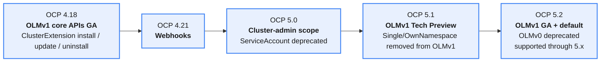
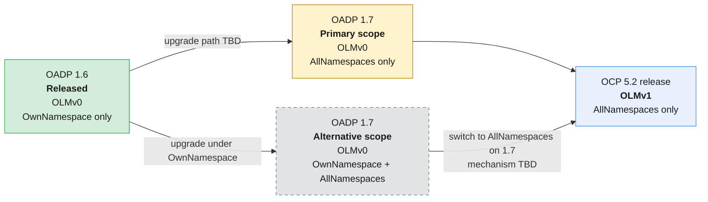

# OLMv1 Transition Timeline

_Status: Draft — 2026-11-20_

This document is a public-safe timeline of the OLMv1 transition and OADP's position in it.
It focuses on release milestones and deliberately does not cover customer migration mechanics; those are a separate TBD study.

## Scope and assumptions

- OADP 1.6 is already released and is the fixed baseline: OLMv0, OwnNamespace only.
- OADP 1.7's primary install-mode scope is AllNamespaces only.
- A possible alternative is a dual-mode 1.7 supporting OwnNamespace + AllNamespaces, allowing customers to upgrade from 1.6 under OwnNamespace and then move to AllNamespaces on 1.7.
- The 1.7 scope decision and all migration mechanics remain TBD.
- OADP switches to OLMv1 in the OpenShift 5.2 release.
- OLMv0 is deprecated at 5.2 but remains supported for the lifetime of OpenShift 5.x.
- The timeline is release-gated, not calendar-dated; exact dates are subject to change.

## Platform milestones

OLMv1 core APIs are GA from 4.18; functionality is added incrementally through 5.2.
The 5.1 release is the OLMv1 Tech Preview gate; 5.2 is GA and the default for new installs.
OLMv1 5.1 removes the OLMv1 Tech Preview Single/OwnNamespace support; OLMv0 still supports install modes.

## OADP release lane

Lanes are ordered by release, not to scale.
1.6 is the released baseline; 1.7 is the next OLMv0 release; the 5.2 release moves OADP to OLMv1.
The primary 1.7 scope is AllNamespaces only. The alternative is a dual-mode 1.7 that lets customers upgrade from 1.6 under OwnNamespace and then switch to AllNamespaces on 1.7.
The switch/reinstall mechanism and the 1.6-to-1.7 upgrade path remain TBD.

## Milestone table

Current OADP baseline: 1.6, OLMv0, OwnNamespace only.

| Release | OLM platform change | OADP position |
|---|---|---|
| 4.18 | OLMv1 core APIs GA: `ClusterExtension` install, update, uninstall | — |
| 4.21 | Webhooks | — |
| 5.0 | Cluster-admin scope; `spec.serviceAccount` deprecated | No OADP release change; 1.6 remains the baseline |
| 5.1 | OLMv1 Tech Preview; OLMv1 Single/OwnNamespace support removed | 1.7 target (OLMv0). Primary scope: AllNamespaces only. Alternative: OwnNamespace + AllNamespaces. Migration TBD. |
| 5.2 | OLMv1 GA and default; OLMv0 deprecated, supported through 5.x | OADP switches to OLMv1 |

## What this timeline does not decide

- Whether 1.7 ships AllNamespaces-only or dual-mode.
- How 1.6 OwnNamespace customers reach 1.7 AllNamespaces under the primary scope.
- How customers move from 1.7 OwnNamespace to AllNamespaces if the alternative ships.
- Whether that move is an OperatorGroup switch or a reinstall.
- Exact release dates.

## Notes

- OLMv1 GA has no install-mode concept: every `ClusterExtension` is cluster-scoped.
- "AllNamespaces" is OLMv0 vocabulary for the topology OLMv1 imposes by default.
- The CSV still exists inside the bundle under OLMv1, but only `install.spec.deployments` is rendered; `installModes`, `permissions`, and `clusterPermissions` become inert metadata.
- The 1.7 migration study owns the customer-facing upgrade and install-mode switch details.
- See [Install-Mode Wiring](install-mode-wiring.md) for the OwnNamespace, AllNamespaces, and OLMv1 component diagrams.

## References

- [Announcing OLM v1](https://www.redhat.com/en/blog/announcing-olm-v1-next-generation-operator-lifecycle-management)
- [OLMv1 design decisions](https://operator-framework.github.io/operator-controller/project/olmv1_design_decisions/)
- [OLMv1 limitations](https://operator-framework.github.io/operator-controller/project/olmv1_limitations/)
- [OLM OperatorGroup design](https://github.com/operator-framework/operator-lifecycle-manager/blob/master/doc/design/operatorgroups.md)
- [OLM OperatorGroup documentation](https://olm.operatorframework.io/docs/concepts/crds/operatorgroup)
